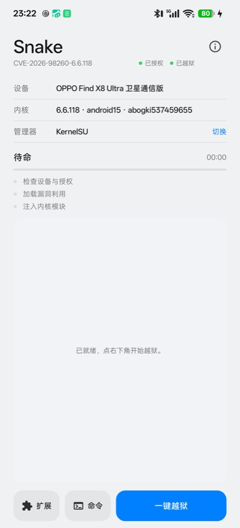
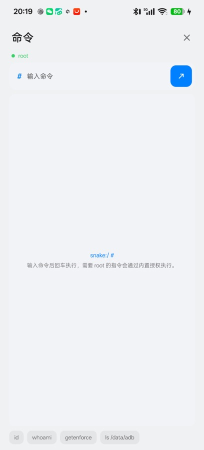
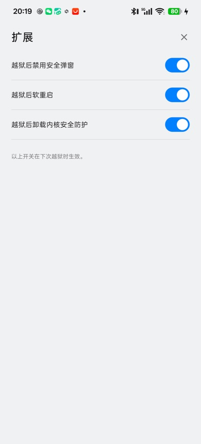
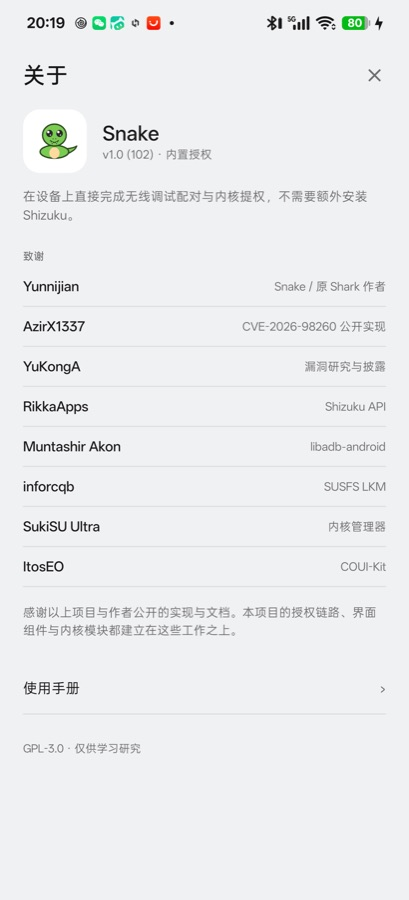

<h1 align="center"> Snake</h1>

<p align="center"><b>多机型 Android 一键临时 Root · 内置授权，免装 Shizuku</b></p>

<p align="center">
  <a href="LICENSE"></a>
  
  
  
  
</p>

Snake 是 [Shark](https://github.com/Yunnijian/Shark) 的改版：界面重做成单页、
包名独立为 `com.android.snake`、只保留内置授权链路。App 自己连接本机无线调试
拿 shell，**不需要安装或启动 Shizuku / Stellar**；拿到临时内核权限后按所选
管理器加载 LKM，得到 KernelSU、KernelSU-Next、BakaSU、SukiSU Ultra 或 FinaSU
的 root 环境。机型支持跟随上游，见下文「跟进上游更新」。

由于包名不同，Snake 和原版 Shark 是两个独立应用，可以共存，各自的配对密钥互不影响。

## 界面

<table align="center">
  <tr>
    <td align="center"><br><sub><b>首页</b></sub></td>
    <td align="center"><br><sub><b>命令</b></sub></td>
    <td align="center"><br><sub><b>扩展</b></sub></td>
    <td align="center"><br><sub><b>关于</b></sub></td>
  </tr>
</table>

## 特性

- **内置授权**：点「一键授权」后 App 自己连接本机无线调试，配对码在通知栏输入，
  提交后通知自动消失。失败时才提示原因，成功不弹多余通知。
- **状态一目了然**：标题旁常驻两个状态点——授权状态与越狱状态（读的是内核里
  KernelSU 模块是否在跑，重启后依然准确），绿点正常、红点未就绪。
- **单页界面**：顶部是机型、内核、管理器（点「切换」更换）；中间是进度与当前环节，
  下面是本次运行的实时输出；底部是「扩展 / 命令 / 一键授权（授权后变一键越狱）」。
- **命令页**：内置 shell，未授权时以普通身份运行，授权后自动切到 root。
- **常用命令**：输入框旁的书签可以把当前命令存成一条带昵称的常用命令；底部「常用命令」
  抽屉里点一行直接执行，支持改名、置顶、删除，以及逐条的「执行前确认」。
- **扩展页**：反 root 弹窗抑制、越狱后软重启、卸载内核安全防护、SUSFS、VFS、
  管理器热切换，以及 Droidspaces 模块下载。开关在下次越狱时生效。
- **五家管理器**：KernelSU、KernelSU-Next、BakaSU、SukiSU Ultra、FinaSU，
  选中哪家就用哪家已安装 APK 里的 `ksud`，所以用哪家要先装哪家。

## 支持范围

| 机型 | 系统 | 完整内核版本 |
| --- | --- | --- |
| OnePlus 16（PYB110） | ColorOS 17 | `6.18.21-android17-5-gf957accaf563-ab15926176-4k`<br>`6.18.21-android17-5-g7fcbffcad3e1-ab16353812-4k` |
| OnePlus 15（PLK110） | ColorOS 17 | `6.12.69-android16-6-g242e1a07f878-ab15865446-4k`<br>`6.12.69-android16-6-g5fd39602326e-ab16372235-4k` |
| OnePlus 15T（PLZ110） | ColorOS 17 | `6.12.69-android16-6-g242e1a07f878-ab15865446-4k`<br>`6.12.69-android16-6-g5fd39602326e-ab16372235-4k` |
| OnePlus Ace7 Pro（PMS110） | ColorOS 17 | `6.12.69-android16-6-g242e1a07f878-ab15865446-4k`<br>`6.12.69-android16-6-g5fd39602326e-ab16372235-4k` |
| OnePlus Ace7（PYF110） | ColorOS 17 | `6.12.69-android16-6-g242e1a07f878-ab15865446-4k`<br>`6.12.69-android16-6-g5fd39602326e-ab16372235-4k` |
| OnePlus Ace6T（PLR110） | ColorOS 17 | `6.12.69-android16-6-g242e1a07f878-ab15865446-4k`<br>`6.12.69-android16-6-g5fd39602326e-ab16372235-4k`<br>`6.12.38-android16-5-g844001fb8721-ab14552068-4k` |
| OnePlus Ace6 Ultra（PMB110） | ColorOS 17 | `6.12.69-android16-6-g242e1a07f878-ab15865446-4k`<br>`6.12.69-android16-6-g5fd39602326e-ab16372235-4k` |
| OnePlus Ace6（PLQ110） | ColorOS 17 | `6.6.118-android15-8-g9bc34d5b0c79-abogki537459655-4k` |
| OnePlus Ace5 Pro（PKR110） | ColorOS 17 | `6.6.118-android15-8-g9bc34d5b0c79-abogki537459655-4k` |
| OnePlus Pad3 Pro（OPD2513） | ColorOS 16/17 | `6.12.69-android16-6-g242e1a07f878-ab15865446-4k`<br>`6.12.69-android16-6-g5fd39602326e-ab16372235-4k`<br>`6.12.58-android16-6-g7704a1ae279b-ab15213644-4k` |
| OnePlus Pad2 Pro（OPD2413） | ColorOS 17 | `6.6.118-android15-8-gc4127a25dcf3-ab15863337-4k` |
| OPPO Find X9 Ultra（PMA110） | ColorOS 17 | `6.12.69-android16-6-g242e1a07f878-ab15865446-4k`<br>`6.12.69-android16-6-g5fd39602326e-ab16372235-4k` |
| OPPO Find X9 Pro（PLG110） | ColorOS 17 | `6.12.69-android16-6-g242e1a07f878-ab15865446-4k`<br>`6.12.69-android16-6-g5fd39602326e-ab16372235-4k` |
| OPPO Find X9（PLJ110） | ColorOS 17 | `6.12.69-android16-6-g242e1a07f878-ab15865446-4k`<br>`6.12.69-android16-6-g5fd39602326e-ab16372235-4k` |
| OPPO Find X9s Pro（PME110EX） | ColorOS 17 | `6.12.69-android16-6-g242e1a07f878-ab15865446-4k`<br>`6.12.69-android16-6-g5fd39602326e-ab16372235-4k` |
| OPPO Find X10（PMX110） | ColorOS 17 | `6.12.69-android16-6-g242e1a07f878-ab15865446-4k`<br>`6.12.69-android16-6-g5fd39602326e-ab16372235-4k` |
| OPPO Find X8 Ultra（PKJ110） | ColorOS 17 | `6.6.118-android15-8-g9bc34d5b0c79-abogki537459655-4k` |
| OPPO Find N5（PKH110） | ColorOS 17 | `6.6.118-android15-8-gc4127a25dcf3-ab15863337-4k` |
| OPPO Pad Mini（OPD2515） | ColorOS 16/17 | `6.12.69-android16-6-g242e1a07f878-ab15865446-4k`<br>`6.12.69-android16-6-g5fd39602326e-ab16372235-4k`<br>`6.12.58-android16-6-g7704a1ae279b-ab15213644-4k` |
| OPPO Pad 5 Pro（OPD2511） | ColorOS 17 | `6.12.69-android16-6-g242e1a07f878-ab15865446-4k`<br>`6.12.69-android16-6-g5fd39602326e-ab16372235-4k` |
| OPPO Pad4 Pro（OPD2409） | ColorOS 17 | `6.6.118-android15-8-gc4127a25dcf3-ab15863337-4k` |
| Realme GT8 Pro（RMX5200） | ColorOS 17 | `6.12.69-android16-6-g242e1a07f878-ab15865446-4k`<br>`6.12.69-android16-6-g5fd39602326e-ab16372235-4k` |
| Realme GT8（RMX6699） | ColorOS 17 | `6.6.118-android15-8-g9bc34d5b0c79-abogki537459655-4k` |
| OPPO K13 Turbo Pro（PLE110） | ColorOS 17 | `6.6.118-android15-8-g9bc34d5b0c79-abogki537459655-4k` |
| Realme Neo8（RMX8899） | ColorOS 16/17 | `6.12.38-android16-5-g844001fb8721-ab14552068-4k`<br>`6.12.69-android16-6-g242e1a07f878-ab15865446-4k`<br>`6.12.69-android16-6-g5fd39602326e-ab16372235-4k` |
| vivo / iQOO 机型 | OriginOS 6/7 | `6.12.58-android16-6-g690108013dcc-abogki576129896-4k`<br>`6.12.58-android16-6-g0a092cc0037a-abogki521987229-4k`<br>`6.12.58-android16-6-gdd6fd5c98918-abogki543627742-4k`<br>`6.12.23-android16-5-g41f4cb1fa7c7-abogki465038634-4k`<br>`6.6.127-android15-8-gd489d4ad2a70-abogki567717946-4k` |
## 支持的管理器

KernelSU、KernelSU-Next、BakaSU、SukiSU Ultra、FinaSU 五家。

管理器 APK 不随 Snake 分发，普通模式会直接使用已安装管理器 APK 里的
`ksud`，所以**用哪家就先装哪家**。

## 使用

1. 安装要用的管理器 APK。想用 Dynamic Switching 的话，建议五家都装上。
2. 打开 Snake，点右下角「一键授权」。授予本地网络与通知权限后，App 会打开开发者
   选项的「无线调试 → 使用配对码配对设备」，保持弹窗开启，在通知栏输入六位配对码。
   配对成功后首页状态变成「待命」，按钮变成「一键越狱」。
3. 按需在首页「管理器」里选目标管理器，在「扩展」里打开需要的开关。
4. 点「一键越狱」，等输出区出现 `DONE` 与 `uid=0(root)`。
5. 成功后管理器会自动拉起；Dynamic Switching 则在扩展页用「管理器热切换」换目标。

配对码每次重启都会变，重启后需要重新配对；锁屏或关掉无线调试可能断连，
回到 App 会自动尝试重连。

## 项目结构

```
Snake/
├── app/                              Android App（Gradle 工程）
│   ├── app/src/main/
│   │   ├── java/com/android/snake/
│   │   │   ├── MainActivity.kt       单页界面、越狱流程、管理器与开关
│   │   │   ├── AdbAuth.kt            内置授权：无线调试配对与 ADB shell 会话
│   │   │   ├── AdbPairingReceiver.kt 通知栏配对码接收
│   │   │   ├── Privileged.kt         后端选择（内置授权 / Stellar / Shizuku 兜底）
│   │   │   ├── DroidspacesModule.kt  Droidspaces 模块下载
│   │   │   └── ManualMarkdown.kt     内置手册的 Markdown 渲染
│   │   ├── jniLibs/arm64-v8a/        exploit runner 与内核模块
│   │   └── assets/                   manual.md、licenses
│   └── keystore.properties           签名配置（不入库）
├── exploit/                          设备端 runner 源码（Rust + C）
│   └── src/                          plant_core.inc + K<版本>_plant.c
├── lkm/                              SUSFS guard 与 Hybrid Mount 源码
├── tools/
│   ├── sync-upstream.sh              一条命令吸收上游机型支持
│   └── merge_device_profiles.py      机型表合并（幂等）
├── .github/workflows/                定时检查上游并自动合并
├── dist/                             构建产物
├── docs/                             README 图片
└── NOTICE / LICENSE
```

## 自己编译

```bash
cd app
./gradlew :app:assembleRelease
```

需要在 `app/keystore.properties` 里配置签名（`storeFile`、`storePassword`、
`keyAlias`、`keyPassword`），该文件已在 `.gitignore` 中排除。

设备端 runner 不在 App 构建里编译，仓库直接使用 `jniLibs` 下已构建好的
`libk*.so`；需要重编时见 `exploit/build-all.sh`。

## 跟进上游更新

只吸收上游的**机型支持**与**后台逻辑**，界面代码独立维护，因此不需要逐版本追。

```bash
./tools/sync-upstream.sh v2.2.1    # 或 upstream/main
```

它拉取指定 ref、覆盖 `jniLibs` 与 `exploit/` 源码、把新机型的
`ExploitKind` / `PROFILE_BY_RELEASE` / `.so` 启动分支合并进 `MainActivity.kt`，
其余 App 层改动会列成 diff 由人判断。`merge_device_profiles.py` 可单独重复执行，
已存在的条目不会重复写入。

`.github/workflows/sync-upstream.yml` 每天北京时间 02:00 自动检查一次上游 tag，
发现新版本就跑同一套流程并提交，也可以在 Actions 页面手动触发。它只改数据层，
不产出 APK（构建需要签名密钥）。

## 许可

- Snake 自研代码采用 GPL-3.0，见 `LICENSE`；第三方组件见 `NOTICE`。
- 通用 KSU LKM 基于 SukiSU Ultra，GPL-3.0。
- SUSFS guard 与 Hybrid Mount 为 GPL-2.0。
- CVE-2026-98260 设计参考 AzirX1337 与 YuKongA 的公开实现（MIT）。
- UI 使用 COUI-Kit（MPL-2.0），内置授权使用 libadb-android（Apache-2.0 / GPL-3.0 双许可）。

感谢以上项目与作者公开的实现与文档。本项目的授权链路、界面组件与内核模块
都建立在这些工作之上。

## 注意

- CVE-2026-98260 是竞态 UAF，任何一次运行都可能导致内核 panic 或重启。
- Dynamic Switching 第一次必须在干净开机状态下加载。
- 仅用于自有设备的系统研究，风险自负。
